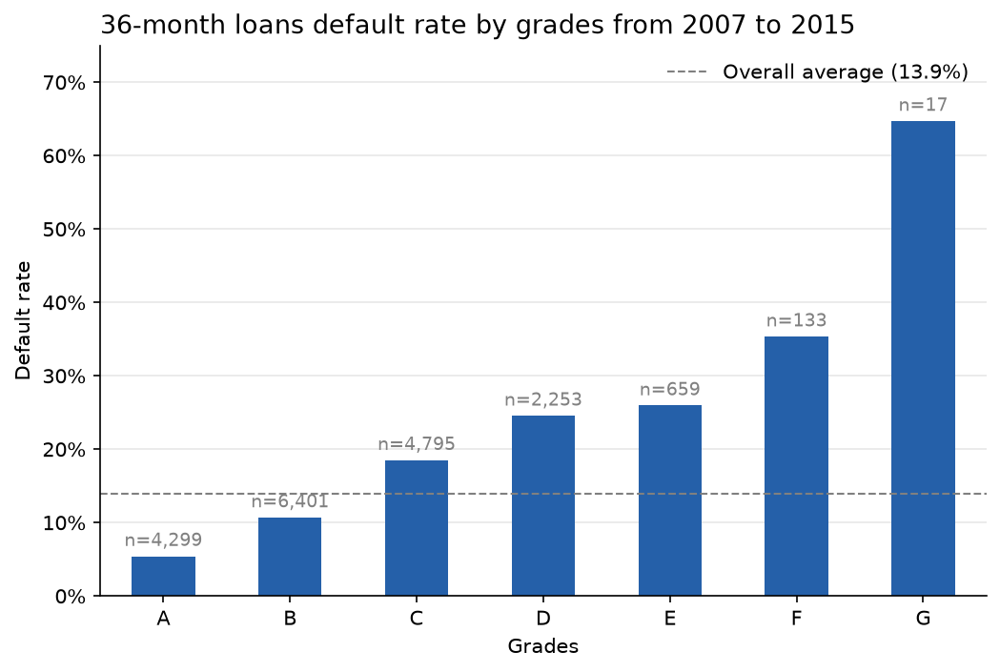

# Credit Risk Modelling: Probability of Default (PD) Scorecard

Predicting the probability that a consumer loan defaults, using LendingClub loan data (2007–2018).
Built the way a bank risk team would: an interpretable **WoE logistic-regression scorecard** (champion)
benchmarked against a **LightGBM** model (challenger), validated **out-of-time**, and turned into a
**credit cut-off strategy**.

> 🚧 Work in progress. Sections marked *TBD* will be filled in as the project develops.

---

## 1. Business problem
A lender needs to decide **who to approve** and **how much risk** each loan carries.
This project estimates each applicant's **Probability of Default (PD)** at the point of application,
converts it into a credit score, and recommends an approval cut-off that balances
**approval rate** against **bad rate**.

Extension: **Expected Loss = PD × LGD × EAD** (Basel / IFRS 9 framing).

## 2. Data
- **Source:** [LendingClub loan data on Kaggle](https://www.kaggle.com/datasets/wordsforthewise/lending-club): `accepted_2007_to_2018Q4.csv.gz` (~2.2M loans × ~150 features)
- **Sample:** a 3% random sample (seed 42, ~68k loans) created with `src/make_sample.py`, to keep development fast
- Data is **not included** in this repo (size + licensing). Download it and place it in `data/`.

**Target definition**
| `loan_status` | Target |
|---|---|
| Charged Off, Default | 1 (bad) |
| Fully Paid | 0 (good) |
| Current, Late, In Grace Period | Excluded (outcome unknown) |
| "Does not meet the credit policy" | Excluded (approved under older underwriting rules) |

**Modelling population**
| Filter | Reason |
|---|---|
| Individual applications only | Joint applications started in late 2015, with too few matured loans to model |
| 36-month loans only | Most 60-month loans issued from 2014 had not matured by the data cut-off |
| Issued 2007–2015 | Later vintages are mostly still running (right-censoring) |

➡️ **18,557 loans, 13.9% default rate**

## 3. Approach
1. **Leakage control:** removed 38 post-origination variables (payments received, recoveries,
   last FICO pull, hardship/settlement fields). Only information available at application is used.
2. **Data cleaning:** dropped IDs, free text and columns that are >90% empty or constant;
   converted dates, `term` and `emp_length` to numbers.
3. **Fairness:** excluded `zip_code` because location can act as a proxy for protected
   characteristics under US fair-lending law (ECOA).
4. **EDA:** default rates by grade, FICO band and other key variables.
5. **Feature engineering:** credit history length, payment-to-income, DTI including the new loan, etc.
6. **Out-of-time split:** train on 2007–2014, test on 2015 (mirrors real deployment).
7. **Champion model:** WoE binning + Information Value feature selection → logistic regression scorecard.
8. **Challenger model:** LightGBM, explained with SHAP.
9. **Scorecard scaling:** PD → points (e.g. 600 points = 50:1 odds, PDO = 20).
10. **Strategy:** approval rate vs bad rate trade-off and recommended cut-off.

## 4. Key findings (EDA)


- Default rates rise steadily from grade A (5.4%) to G (64.7%, but based on only 17 loans).
- Borrowers with FICO 660–679 defaulted at 18.4%, about **4.6×** the rate of those with FICO 750+ (4.0%).

## 5. Results *(TBD)*
| Model | AUC | Gini | KS |
|---|---|---|---|
| LendingClub grade (benchmark) | TBD | TBD | TBD |
| WoE Logistic Scorecard | TBD | TBD | TBD |
| LightGBM | TBD | TBD | TBD |

## 6. Business impact *(TBD)*
*e.g. "At a cut-off of X points, the bad rate falls from A% to B% while keeping a C% approval rate."*

## 7. Project structure
```
credit-risk-modelling/
├── data/                   # not tracked: raw data & sample
├── notebooks/
│   ├── 01_explore.ipynb    # first look at the data
│   └── 02_eda.ipynb        # default rates by variable
├── src/
│   ├── make_sample.py      # creates the 3% random sample
│   └── data_cleaning.py    # leakage removal, cleaning, target definition
├── reports/figures/        # charts used in this README
├── requirements.txt
└── README.md
```

## 8. How to run
```bash
git clone https://github.com/jayczw04/credit-risk-modelling.git
cd credit-risk-modelling
python3 -m venv .venv && source .venv/bin/activate
pip install -r requirements.txt
# download accepted_2007_to_2018Q4.csv.gz into data/
python src/make_sample.py
```

## 9. Limitations & next steps
- **Sample-based:** built on a 3% sample. Final results should be confirmed on the full dataset.
- **Scope:** individual, 36-month loans only. Joint and 60-month loans would need their own models.
- **Selection bias:** the model only sees approved applicants. Reject inference using
  `rejected_2007_to_2018Q4.csv.gz` is a possible extension.
- Add **LGD** and **EAD** models to estimate Expected Loss.
- Monitor stability over time with **PSI**.

## Author
**Jay**: aspiring Risk Analyst · [LinkedIn](https://www.linkedin.com/in/jaychong04)